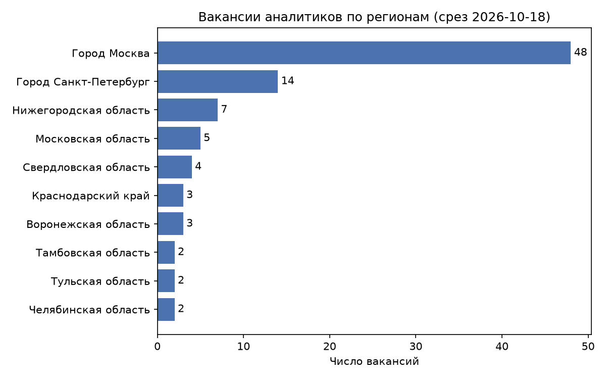
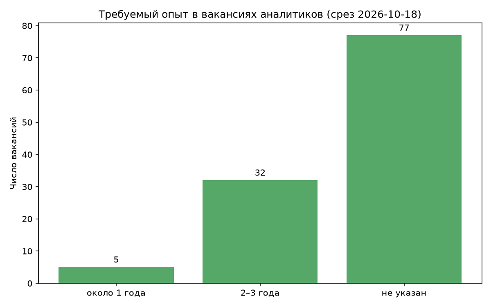

# Анализ вакансий аналитиков данных

Проект собирает вакансии аналитиков с портала «Работа в России»
([trudvsem.ru](https://trudvsem.ru)) через открытый API, копит ежедневные
срезы в SQLite и анализирует рынок: где расположены вакансии, какой опыт
требуется, какие навыки встречаются чаще.

Проект учебный: я возвращаюсь в программирование и осваиваю SQL, Pandas
и автоматизацию на реальных данных.

## Как собираются данные

- `collect.py` запрашивает у API вакансии по фразе «аналитик данных» и
  сохраняет в таблицу `vacancies` (название, регион, работодатель, зарплата,
  график, требования). Каждая запись помечена датой среза (`snapshot_date`).
- GitHub Actions запускает сбор раз в сутки и коммитит обновлённую базу
  `data/vacancies.db`, так что в репозитории копится история.

## Структура репозитория

```
├── collect.py            # сбор данных с API
├── analysis.py           # разбор требований, сводки
├── sql/                  # SQL-запросы (разметка, регионы и т.д.)
├── data/vacancies.db     # база с ежедневными срезами
├── reports/              # графики и выгрузки
└── .github/workflows/    # ежедневный запуск сбора
```

## Первые результаты

Срез от 18.10.2026, вакансии, в названии которых есть «аналитик» или
«analyst» (114 вакансий из ~500 в выдаче):

- **География.** Больше половины вакансий приходится на Москву (50) и
  Санкт-Петербург (14). В Башкортостане найдена одна вакансия.
- **Опыт.** Явных предложений «без опыта» нет. Минимальное требование,
  которое удалось извлечь, это 1 год (4 уникальные вакансии). В 32 вакансиях
  требуется от 2–3 лет (минимум). У 77 вакансий опыт определить не удалось.
- **Удалёнка.** Дистанционный формат указан у 3 вакансий, но поле формата
  занятости пусто у ~80% вакансий, поэтому долю удалённой работы по этим
  данным оценить нельзя.
- **Работодатели.** Заметную часть выдачи составляют вакансии одного крупного
  банка (во всей выдаче у него 40 вакансий, больше всех).

- **Опыт.** Явных предложений «без опыта» нет. Минимальное требование,
  которое удалось извлечь, это 1 год (4 уникальные вакансии). В 32 вакансиях
  требуется от 2–3 лет (минимум). У 77 вакансий опыт определить не удалось:
  у 37 из них текст требований пуст, у остальных 40 опыт в сохранённом
  фрагменте не указан.
- **Навыки.** У 77 из 114 аналитических вакансий есть текст требований.
  Чаще всего в нём упомянуты Excel (26%) и SQL (22%), реже Python (14%),
  BI-системы и 1С (по 12%), статистика (5%). Тексты сохраняются до 300 символов,
  поэтому реальные доли могут быть выше, а разница между Excel и SQL на такой
  выборке не значима.
  
<p align="center">
  
</p>

<p align="center">
  
</p>

*«Не указан» включает вакансии без текста требований и те, где опыт
в сохранённом фрагменте не назван. Графики построены по срезу на дату
в заголовке и сами не обновляются.*

## Ограничения данных

- Источник один (государственная база), крупные работодатели часто размещают
  вакансии на других площадках. Выводы относятся к этой базе, а не ко всему рынку.
- Поиск идёт по тексту, поэтому в выдаче много посторонних вакансий (например,
  фармацевты). Я отфильтровал их по названию вакансии. Профессии на границе
  (экономисты, маркетологи) в анализ не входят.
- Регион в данных может быть регионом работодателя, а не места работы.
- Текст требований сохраняется до 300 символов, и часть упоминаний
  опыта и навыков могла не попасть в базу.
- Опыт извлекается из текста регулярными выражениями и бывает неточным:
  например, «SQL от 1 года» относится к навыку, а не к общему стажу.

## Запуск

```bash
python -m venv .venv
.venv\Scripts\activate
pip install -r requirements.txt
python collect.py     # собрать срез
python analysis.py    # посчитать сводки
```

## Планы

- [ ] Динамика числа вакансий по дням
- [ ] Графики и дашборд